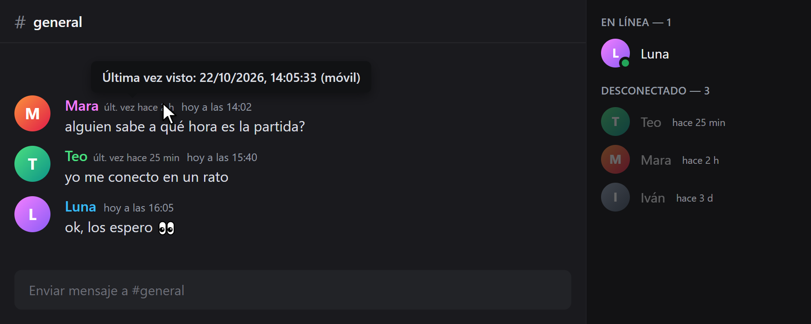
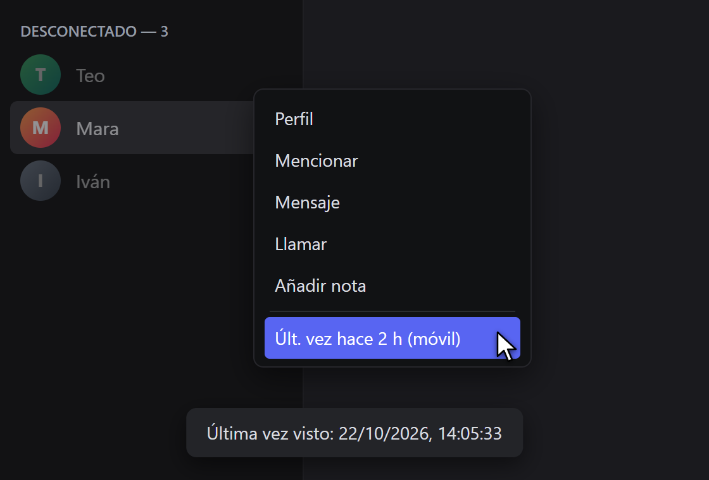

# LastSeen

Discord te dice que alguien está desconectado, pero no desde cuándo. LastSeen sí.

Cada vez que alguien se desconecta, el plugin se guarda la hora. Desde ahí, al lado de su nombre (en el chat y en la lista de miembros) te sale algo como "últ. vez hace 2 h". Pasas el ratón y ves la fecha exacta y si estaba en el móvil, en el PC o en la web.

Sirve para **Vencord** y para **BetterDiscord** ([ver más abajo](#versión-para-betterdiscord)).



<sub>Demostración con nombres y fotos inventados.</sub>

## Índice
1. [Cómo funciona](#cómo-funciona)
2. [Limitaciones](#limitaciones)
3. [Requisitos](#requisitos)
4. [Instalación paso a paso](#instalación-paso-a-paso)
5. [Activar el plugin](#activar-el-plugin)
6. [Actualizar](#actualizar)
7. [Desinstalar](#desinstalar)
8. [Problemas frecuentes](#problemas-frecuentes)
9. [Versión para BetterDiscord](#versión-para-betterdiscord)
10. [Estructura del repositorio](#estructura-del-repositorio)
11. [Aviso](#aviso)

## Cómo funciona
Discord envía a tu cliente los cambios de estado de las personas que ves (conectado, ausente, no molestar, desconectado), junto con la plataforma desde la que están. El plugin escucha esos cambios:

- Cuando alguien pasa de estar conectado a **desconectado**, guarda la hora y la plataforma en la que estaba.
- Mientras esa persona siga desconectada, se muestra "últ. vez hace X" junto a su nombre: en la cabecera de sus mensajes (texto completo) y en la lista de miembros (texto corto).
- Al pasar el ratón por encima se ve la fecha y hora exactas y la plataforma.
- Los datos se guardan en el almacenamiento local de Vencord, así que se conservan al cerrar y abrir Discord. No se envían a ningún sitio.

## Limitaciones
- **Empieza vacío.** Solo conoce a la gente que ves desconectarse después de instalarlo.
- **Solo registra con Discord abierto.** Si alguien se conecta y se desconecta mientras tu Discord está cerrado, el plugin no se entera.
- **Usuarios invisibles.** Discord no envía ningún dato de quien está en modo invisible, por lo que de esas personas no se puede saber nada. Aparecen como desconectadas, igual que si lo estuvieran de verdad.
- **Solo ves a quien Discord te muestra.** Si no compartes servidor ni amistad con alguien, o su presencia no está cargada, no habrá datos.
- **No funciona en el navegador ni en el móvil.** Vencord solo existe para la aplicación de escritorio (y para el navegador con otra extensión distinta).

## Requisitos
- Windows, macOS o Linux con la aplicación de escritorio de Discord instalada.
- [Node.js LTS](https://nodejs.org) (versión 20 o superior).
- [Git](https://git-scm.com).
- pnpm (se instala con un comando, ver más abajo).
- Conexión a internet para descargar las dependencias (unos 200 MB).

## Instalación paso a paso
Los plugins propios no están en el instalador oficial de Vencord. Los plugins van compilados dentro de Vencord, así que hay que descargar su código fuente, añadir este plugin y volver a compilar. Los ajustes y los plugins que ya tengas no se pierden.

Los comandos son para Windows (PowerShell). En macOS y Linux son los mismos, salvo la instalación de Node y Git.

### 1. Instalar Node.js y Git
En Windows, con winget:
```bash
winget install OpenJS.NodeJS.LTS Git.Git
```
Cierra la terminal y ábrela de nuevo para que reconozca los programas. Comprueba que funcionan:
```bash
node -v
git --version
```

### 2. Instalar pnpm
```bash
npm i -g pnpm
```

### 3. Descargar Vencord
```bash
git clone https://github.com/Vendicated/Vencord.git
cd Vencord
```

### 4. Descargar este plugin y copiarlo
Descarga este repositorio (botón verde **Code → Download ZIP**, o con `git clone https://github.com/ccrccne/vencord-lastseen.git`).

Copia la carpeta `lastSeen` dentro de `Vencord/src/userplugins/`. Si la carpeta `userplugins` no existe, créala. Debe quedar así:
```
Vencord/
└── src/
    └── userplugins/
        └── lastSeen/
            └── index.tsx
```

### 5. Instalar dependencias y compilar
Dentro de la carpeta `Vencord`:
```bash
pnpm install
pnpm build
```
`pnpm install` tarda unos minutos la primera vez. Si aparecen avisos amarillos (`WARN`) sobre la versión de pnpm o la velocidad de descarga, no son errores.

### 6. Inyectar en Discord
Cierra Discord por completo, incluido el icono de la bandeja del sistema, y ejecuta:
```bash
pnpm inject
```
Es interactivo: te muestra tus instalaciones de Discord y eliges la que quieras con las flechas y Enter. Cuando termine, abre Discord.

## Activar el plugin
1. En Discord, abre **Ajustes de usuario**.
2. En la sección **Vencord Settings**, entra en **Plugins**.
3. Escribe `LastSeen` en el buscador.
4. Activa el interruptor.

El plugin empieza a registrar desde ese momento. Para probarlo, espera a que alguien que tengas visible se desconecte: a partir de entonces verás su "últ. vez".

## Actualizar
Para actualizar Vencord o este plugin, dentro de la carpeta `Vencord`:
```bash
git pull
pnpm install
pnpm build
pnpm inject
```
Para actualizar solo este plugin, vuelve a copiar la carpeta `lastSeen` a `src/userplugins/` antes de compilar. Como el plugin va compilado dentro de Vencord, hay que repetir la compilación cada vez que Vencord se actualice.

## Desinstalar
- **Solo el plugin:** desactívalo en Ajustes → Vencord → Plugins. Si quieres borrarlo del todo, elimina `src/userplugins/lastSeen`, compila (`pnpm build`) e inyecta de nuevo.
- **Todo Vencord:** con Discord cerrado, ejecuta en la carpeta de Vencord:
  ```bash
  pnpm uninject
  ```
- **Datos guardados:** se borran al limpiar los datos de Vencord desde Ajustes → Vencord, o al desinstalarlo.

## Problemas frecuentes
- **`node`, `git` o `pnpm` no se reconoce:** cierra y abre la terminal tras instalarlos. Si sigue igual, reinicia el equipo.
- **El plugin no aparece en la lista:** comprueba que la carpeta está en `src/userplugins/lastSeen/index.tsx` (no una carpeta dentro de otra), que ejecutaste `pnpm build` después de copiarla y que volviste a ejecutar `pnpm inject`.
- **`pnpm inject` no encuentra Discord:** asegúrate de que Discord está instalado y cerrado del todo. También puedes indicar la ruta cuando el instalador la pida.
- **Error de compilación en `pnpm build`:** Vencord cambia con frecuencia. Si una actualización rompe el plugin, abre un *issue* en este repositorio con el mensaje de error.
- **Se ve "últ. vez" pero con datos viejos o vacíos:** el plugin solo guarda lo que ve con Discord abierto. Dale tiempo.

## Versión para BetterDiscord
BetterDiscord es otro mod de Discord. Allí los plugins son un único archivo que se copia a una carpeta, sin compilar nada.

**Diferencia con la versión de Vencord:** en BetterDiscord la información se ve **haciendo clic derecho sobre un usuario**. Al final del menú aparece "Últ. vez hace X (plataforma)". Si pulsas esa opción, se muestra un aviso con la fecha y hora exactas. No aparece junto al nombre en los mensajes.



### Instalación
1. Instala [BetterDiscord](https://betterdiscord.app) si no lo tienes.
2. Descarga el archivo [`betterdiscord/LastSeen.plugin.js`](betterdiscord/LastSeen.plugin.js) de este repositorio (ábrelo y pulsa el botón de descarga, **Download raw file**).
3. En Discord, ve a **Ajustes de usuario → BetterDiscord → Plugins** y pulsa **Open Plugins Folder**.
4. Copia `LastSeen.plugin.js` en esa carpeta.
5. Vuelve a la lista de plugins y activa **LastSeen**.

Las mismas [limitaciones](#limitaciones) se aplican: empieza vacío, solo registra con Discord abierto y no ve a los usuarios invisibles.

No uses Vencord y BetterDiscord a la vez: instala solo uno de los dos.

## Estructura del repositorio
```
vencord-lastseen/
├── lastSeen/
│   └── index.tsx             # plugin para Vencord
├── betterdiscord/
│   └── LastSeen.plugin.js    # plugin para BetterDiscord
├── images/                 # capturas de demostración
├── .gitignore
└── README.md
```

## Aviso
Los mods de cliente como Vencord y BetterDiscord van contra los Términos de Servicio de Discord. En la práctica rara vez se sanciona su uso, pero el riesgo existe. Este plugin solo lee datos que Discord ya envía a tu cliente y no automatiza ninguna acción. Úsalo bajo tu propia responsabilidad.

Autor: **cancercocaine** (Discord) · [ccrccne](https://github.com/ccrccne) (GitHub)
